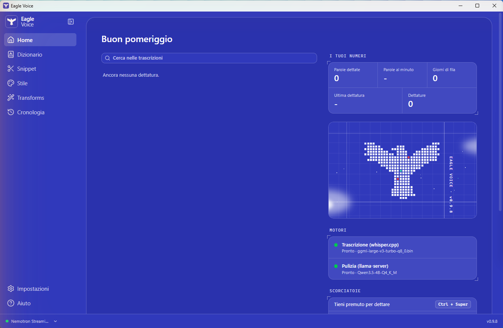
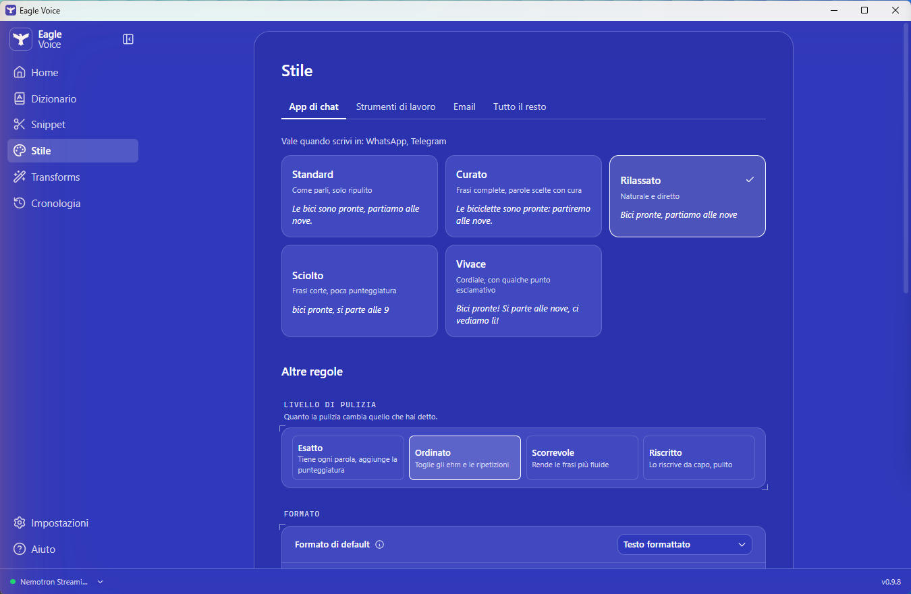

# eagleVoice

A local, privacy-first voice dictation app for Windows. Hold a hotkey, speak, release: the text
appears in whatever field has focus. Speech recognition runs on your own machine, an optional
local LLM cleans up the text, and nothing leaves the PC unless you turn on the optional cloud
quality mode.

eagleVoice is a fork of [Handy](https://github.com/cjpais/Handy) by CJ Pais. Handy provides the
Tauri shell, audio capture, model management, tray and the base settings UI. The parts listed
under "What I built on top of Handy" were designed and developed by me, Nicholas Dotto, with
Claude Code (Anthropic) as an AI programming assistant.

| Home | Writing styles |
| --- | --- |
|  |  |

Screenshots from a fresh install, interface in Italian.

## What it does

- **Push-to-talk and hands-free dictation.** Ctrl+Win by default for push-to-talk, a second
  combination for hands-free mode, Esc to cancel, and a shortcut to paste the last dictation again.
- **On-device speech recognition.** whisper.cpp runs as a local server on the GPU; the audio is
  decoded in pieces split on voice activity while you are still talking, so the text is ready
  shortly after you release the key. Handy's in-process engine stays as a fallback.
- **Optional LLM cleanup.** A local llama.cpp server removes fillers, fixes punctuation and
  self-corrections ("one, no, two") at four levels: Exact, Tidy, Smooth and Rewrite. An optional
  quality mode uses the Anthropic API, with the key read only from `ANTHROPIC_API_KEY`.
- **Paste into any app**, with the result checked and the clipboard restored afterwards.

## What I built on top of Handy

- **Dictation pipeline** (`src-tauri/src/flow.rs`): hotkey, focused-field context, microphone,
  raw transcript, cleanup, paste, then observation of the user's edits. Every step is timed.
- **ASR module** (`src-tauri/src/asr/`): external whisper.cpp server with chunked decoding,
  a recognition prompt built from the user's dictionary, filters for common hallucinations,
  engine warm-up, microphone ranking and a fallback selector.
- **Cleanup module** (`src-tauri/src/cleanup/`): prompts per level and format, writing styles per
  app category (chat apps, team tools, email, everything else), guards that reject an LLM answer
  which drops content or changes meaning, and "Transforms" such as Polish and Prompt Builder that
  rewrite selected text.
- **Self-learning dictionary**: words, replacements and snippets; when you correct a pasted
  dictation by hand, the app spots the correction, classifies it and can learn it, with undo.
- **Windows integration** (`src-tauri/src/win/`): UI Automation to read the focused field and the
  app category, global hotkeys with a hook watchdog, paste with a verified outcome, clipboard
  transactions, replacement of a selection or of the last dictation.
- **New UI**: a hub with home statistics, dictionary, snippets, styles, transforms, history with
  archive, engines and settings; a floating dictation bar that can dock to any screen edge; a
  custom eagle visual identity (icons, light and dark theme, reduced-motion support); Italian and
  English strings for everything I added.
- **Tests**: the unit tests for the parts above, in Rust next to the code (`flow.rs`, `asr/`,
  `cleanup/`, `win/`, the hook watchdog) and in TypeScript (`app/src/lib/*.test.ts` and the
  history actions). The other tests come from Handy, such as those in the managers, settings
  and audio code and `app/src/lib/utils/keyboard.test.ts`.

## Stack

- Tauri 2, Rust (backend in `app/src-tauri`)
- React, TypeScript, Vite, Tailwind (frontend in `app/src`)
- whisper.cpp and llama.cpp as local servers; Silero VAD
- Windows APIs through the `windows` crate (UI Automation, COM, keyboard hooks)

## Build and run

Windows 11, Rust stable, [Bun](https://bun.sh), Visual Studio Build Tools with the C++ workload.

```powershell
cd app
bun install
bun run tauri dev          # development build with hot reload
bun run tauri build --debug --no-bundle   # executable in src-tauri\target\debug
```

`tools/build-app.ps1` wraps the same commands inside the Visual Studio Developer Shell with the
Ninja generator, and `tools/build-transcribe-cpp.ps1` prebuilds Handy's native transcription
library once into `%TCPP_ROOT%` (default `%LOCALAPPDATA%\tcpp`), where `build-app.ps1` picks it
up. Both are optional helpers for my machine setup.

The GPU engines are not bundled. By default the app looks for them next to the repository root:
`bin/whisper` and `bin/llama` for the whisper.cpp and llama.cpp server binaries, and `models/` for
the GGUF models. The paths can be changed in the settings.

The speech models for Handy's in-process engine (the fallback) are downloaded from inside the app,
from Handy's hosting (`blob.handy.computer` and the `handy-computer` organization on Hugging Face).
Each model has its own license; some are non-commercial. See
[`THIRD_PARTY_NOTICES.md`](THIRD_PARTY_NOTICES.md).

## Test

```powershell
cd app
bunx tsc --noEmit
bun run lint
bun test src
cd src-tauri
cargo test
```

Tests that need a real GPU server or a desktop session are marked `#[ignore]`.

## Status

Personal prototype, used daily on one Windows PC. It is not in production, there is no installer
and no CI on GitHub. The Windows integration is Windows-only; Handy's macOS and Linux code is still
there but I have not tested my changes on those platforms.

## Based on Handy by CJ Pais, MIT License

This project is a fork of [Handy](https://github.com/cjpais/Handy) by CJ Pais, released under the
MIT License. The original license is kept in [`app/LICENSE`](app/LICENSE). Thanks to CJ Pais and
the Handy contributors for the foundation. eagleVoice is not endorsed by or affiliated with Handy;
the Handy name and brand assets are not used.

## License

MIT, see [`LICENSE`](LICENSE). Third-party components and their licenses are listed in
[`THIRD_PARTY_NOTICES.md`](THIRD_PARTY_NOTICES.md). Security reports: see
[`SECURITY.md`](SECURITY.md).
